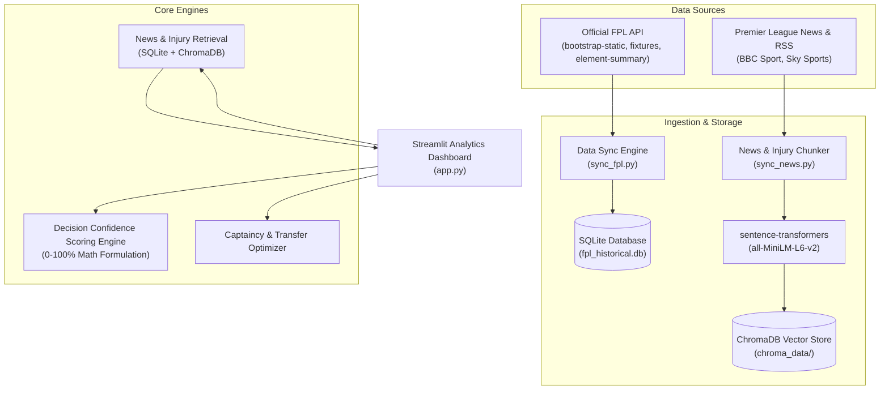

# ⚽ PL Fantasy Predictor

A deterministic decision-support dashboard for Fantasy Premier League (FPL) managers. It combines official FPL statistics, fixtures, historical gameweek data, player analytics, squad planning, and source-linked football news and injury records. No Gemini API key or conversational AI service is required.

---

## 🌟 Key Features

1. **📊 FPL Player Statistics Explorer**: Filter and search through all 660+ active Premier League players by club, position, and price with underlying statistics ($xG$, $xA$, $xGI_{90}$, Points Per Million).
2. **🗓️ Fixtures & FDR Tracker**: Real-time fixture schedule with official Premier League Fixture Difficulty Ratings (FDR 1 to 5) and home/away difficulty indicators.
3. **⚔️ Head-to-Head Player Comparison**: Interactive 6-dimensional Plotly radar chart and side-by-side metric comparison table with winning badges.
4. **🔁 Transfer Decision Evaluator**: Evaluates Player OUT vs Player IN moves, checking bank affordability, schedule swing, expected point delta, and confidence gain.
5. **👑 Captaincy Optimizer (MCDA)**: Multi-criteria decision analysis ranking the top 5 captain picks using form, fixture difficulty, home advantage, and attacking ceiling.
6. **📰 News & Injury Radar**: Source-linked RSS articles and official FPL injury/availability updates, indexed in the retained ChromaDB collection for filtering and retrieval.
7. **🎯 Decision Confidence Score (0–100%)**: A transparent Python scoring formula using form, fixture ease, underlying statistics, value, team strength where available, and injury/rotation adjustments.
8. **🔍 Explainable scoring**: Shows score drivers, drag factors, data limitations, and applied penalties; unavailable Team Delta ratings remain N/A.
9. **🔄 Automatic synchronization**: A worker refreshes FPL data and news independently of browser visits, records each sync attempt, and preserves saved data on upstream errors.
10. **🏆 My Team**: Persistent squad management, XI/bench optimization, transfers, captaincy, alternatives, risk radar, form trends, and fixture timeline.

---

## 🏗️ System Architecture



---

## 🗄️ Database & Vector Schema

### 1. SQLite Structured Warehouse (`data/fpl_historical.db`)
- `teams`: ID, club name, short name, home/away attack & defence strength ratings.
- `players`: ID, current team ID, position (GKP/DEF/MID/FWD), price, status, injury news, form, xG, xA, current gameweek points, total points.
- `fixtures`: Event (Gameweek 1-38), home/away teams, kickoff time, FDR difficulty (1-5), scores, started/finished flags, and provisional-points status.
- `player_gameweek_history`: Match-by-match breakdown (minutes, goals, assists, bonus, points, xG, xA).

### Live match data and refresh behavior

The official FPL endpoints used are `bootstrap-static` (player totals, current `event_points`, and availability), `fixtures` (scores plus `started`, `finished`, and `finished_provisional`), and `element-summary/{player_id}` (per-fixture player history). Completed fixture rows are aggregated into one record per gameweek; unfinished fixtures are excluded, and provisional FPL points are marked in the player profile. Current gameweek points are stored from the bootstrap response for every player; they are source values and may change until the FPL API finalizes the gameweek. Fixture cards show source scores and distinguish live, provisional, final, and scheduled states.

Player-history fetching rotates through all players in bounded batches during normal syncs. To populate existing missing histories immediately, run `python -m src.ingestion.sync_fpl --history-backfill`. The command first refreshes the official player and fixture data, then fetches each player not yet successfully processed. Progress and failures are stored in SQLite, so rerunning resumes safely; use `--limit N` for a bounded run. Empty source histories do not erase existing records.

When Streamlit is running, its process-wide scheduler checks every 15 minutes on matchdays and every 6 hours otherwise. A matchday is identified by a fixture scheduled for today, a started unfinished fixture, or a provisional fixture kicked off within the last 24 hours; stale provisional flags from earlier rounds do not keep the 15-minute interval active indefinitely. It also checks for stale data at startup. An open dashboard checks the last-success timestamp every 30 seconds and reruns only after a successful background sync. The sidebar's **Sync Fresh FPL Data Now** action performs an immediate synchronized refresh and reports errors/status. Updates do not continue when the Streamlit server process exits; closing only the browser leaves the server running, while computer sleep pauses effective refreshes and shutdown stops them. Use a separate scheduled service if updates are required while this app is stopped.

### 2. ChromaDB Vector Store (`data/chroma_data/`)
- **Collection**: `football_news`
- **Embedding Model**: `sentence-transformers/all-MiniLM-L6-v2` (384-dimensional dense vectors, normalized for cosine similarity).
- **Metadata**: `title`, `source`, `category` (injury, press_conference, transfer), `published_at`, `player_tags`, `team_tags`.

---

## 🚀 Quickstart & Installation

### Option 1: Local Virtual Environment (Recommended)

1. **Clone or navigate to the project directory**:
   ```bash
   cd "flp footba"
   ```

2. **Activate the virtual environment**:
   ```powershell
   # Windows PowerShell
   .\.venv\Scripts\Activate.ps1
   ```

3. **Configure Environment Variables**:
   Copy `.env.example` to `.env`:
   ```bash
   cp .env.example .env
   ```
   No AI provider credentials are needed. Keep `.env` local and untracked. Configure `FPL_SCHEDULER_MODE` and persistent data paths only when needed.

4. **Optional initial sync** (news and FPL sync run automatically after the app/worker starts; manual commands are available):
   ```bash
   python -m src.ingestion.sync_fpl
   python -m src.ingestion.sync_news
   ```

5. **Launch the Streamlit Dashboard**:
   ```bash
   streamlit run app.py
   ```
   Open your browser at `http://localhost:8501`.

---

### Option 2: Docker Compose Deployment (Linux host with persistent disk)

The Compose setup runs Streamlit and the scheduler worker as separate containers. Both mount the
same host data directory. The worker refreshes FPL data every 15 minutes on matchdays and every
6 hours otherwise, and refreshes news/injury sources at the configurable news interval (6 hours
by default). Cross-process locks prevent duplicate FPL or news jobs. Historical player ingestion
runs in bounded batches rather than performing a full backfill on each startup. The app reports
worker health from its heartbeat.

Use a supported Linux host where you control Docker Engine and the Compose plugin, with outbound
HTTPS access to the FPL API, configured news sources, and Hugging Face for the embedding model
download on first ingestion.
Attach a durable local block-storage filesystem; do not put SQLite WAL data on an unverified network filesystem. Docker restart
policies cannot keep services available while the host is stopped, and a bind mount is only as
durable as its underlying disk and backups.

```bash
cp .env.example .env
# Edit .env; never commit it. Set FPL_DATA_DIR to the mounted persistent disk path.
chmod 600 .env
sudo mkdir -p /srv/fpl-assistant/data
# The containers run as UID/GID 10001 and need write access to this directory.
sudo chown 10001:10001 /srv/fpl-assistant/data
sudo chmod 750 /srv/fpl-assistant/data
# Set FPL_DATA_DIR=/srv/fpl-assistant/data in .env before starting Compose.
docker compose up --build -d
```

Compose binds the app only to host loopback (`127.0.0.1:8501`). Put it behind a separately
configured TLS reverse proxy and access-control layer before allowing remote users; do not expose
the Streamlit port directly to the public internet. The current Compose setup does not configure
TLS, authentication, a public hostname, firewall rules, or a hosting account.

The app and worker run the same locally built image tag, so their Python runtime and installed
dependencies are identical for a deployment. The app and worker mount the same directory at
`/app/data` and explicitly use
`/app/data/fpl_historical.db`, `/app/data/chroma_data`, and `/app/data/raw`. Both containers use
the same image source, Python dependencies, and non-root UID/GID 10001. Confirm the mounted host
directory is writable by that UID before startup. Use `docker compose ps` and
`docker compose logs fpl-sync-worker` to inspect service state. The app does not start an embedded
scheduler in external mode. The manual FPL refresh remains available and shares the worker's
cross-process synchronization lock.

#### Moving the existing local data to the host

Do not start Compose against an empty data directory if the existing database and vector
collection must be retained. Stop the local app first. Copy the complete existing `data/`
directory (including `fpl_historical.db`, any SQLite `-wal`/`-shm` files, `chroma_data/`, and
`raw/`) to the mounted host disk, preserving all files. Keep the source copy unchanged. Verify
the destination file inventory, database row counts, and Chroma collection count against the
source before starting either container. Apply the required host ownership to the copied target
only after verifying the copy. If validation fails, leave the original untouched and do not
start Compose with the incomplete destination.

#### Durable data, backup, and recovery

SQLite (`fpl_historical.db` and its WAL/SHM files when present), ChromaDB (`chroma_data/`),
and raw source caches are kept under `/app/data` in the shared host mount. A conservative
consistent backup procedure is:

```bash
docker compose stop pl-fantasy-predictor fpl-sync-worker
sudo tar -C /srv/fpl-assistant -czf /secure-backup-location/fpl-data-$(date +%F-%H%M%S).tar.gz data
docker compose start fpl-sync-worker pl-fantasy-predictor
```

Store encrypted backups on a different disk or backup service, and monitor that backups complete.
Test recovery without touching the only copy: extract an archive into a separate empty test
directory, point a separate Compose project/configuration at that directory, and verify SQLite
row counts plus the Chroma collection before considering it recoverable. Never extract a test
restore over the live data path. A bind mount does not protect against disk or host loss.

#### Credentials and unavailable Team Delta inputs

The remaining app does not require an AI provider key. Keep any unrelated secrets out of source
control and images. The official FPL API currently reports zero for all four team-strength fields
across the 20 clubs. The app treats those ratings as unavailable: Team Delta displays `N/A` and is
excluded from the confidence score, with remaining factor weights renormalized. Do not manually
seed invented ratings.

The missing Team Delta inputs do not prevent other app features from working.

FPL scheduling is independent of browser visits but still depends on the Linux host, Docker
daemon, attached disk, network, and upstream FPL API being available. The worker heartbeats every
15 seconds while the scheduler process is alive, including during startup synchronization; the web container waits for a healthy
worker before starting. A stale heartbeat makes it unhealthy, and an unexpectedly stopped
scheduler thread causes the worker container to exit so its restart policy can recover it. FPL and
news synchronization errors are recorded independently in SQLite and retried at the next interval;
they do not erase existing records. The app's 30-second status watcher invalidates cached views after either FPL or news
attempts so the UI reads committed data and current attempt status. News feeds that fail are reported
as partial/error rather than being described as a fully successful refresh. A manual news refresh
is also available in the Data Sync & Status panel.

---

## 🧪 Running Automated Tests

Run the complete test suite with `pytest`:
```bash
pytest tests/ -v
```

Tests cover:
- Mathematical accuracy of the Decision Confidence Scoring rubric.
- Penalty multipliers for doubtful and confirmed injured players.
- SQLite repository CRUD, filtering, and fuzzy searching.
- ChromaDB vector chunking, embedding generation, and semantic query matching.

---

## 🎓 College Viva & Presentation Guide

When presenting this project to professors and evaluators, emphasize these key software engineering highlights:

1. **Deterministic FPL decisions**: `DecisionScoringEngine` computes transparent 0–100 scores from stored FPL statistics, form, fixtures, and availability; there is no generative model in the scoring path.
2. **Source-backed news**: Retained ChromaDB and MiniLM retrieval index articles and injury updates with source metadata for News & Injury Radar and My Team.
3. **Idempotent Data Sync**: The system is future-proof. Running the app 1 year from now pulls the active season's goals, transfers, and fixtures via `ON CONFLICT(id) DO UPDATE` without database corruption.
4. **Local CPU Embeddings**: Using `all-MiniLM-L6-v2` guarantees fast (<15ms) inference on standard laptops without requiring a GPU or paid embedding API credits.

---

## News and injury ingestion

`src.ingestion.sync_news` combines current official FPL player-availability notes from SQLite with
the configured RSS feeds. It preserves each feed's source, article URL, and publication date,
tags known player/team entities, categorizes relevant injury records, and stores deterministic
chunks in the existing `football_news` ChromaDB collection. Chunks are upserted by stable IDs, so
repeated fetches update rather than multiply the same documents. News retrieval, embeddings, and
vector storage remain part of the News & Injury Radar and My Team risk/evidence features; they do
not invoke a conversational model.

The worker runs news refresh using `NEWS_REFRESH_INTERVAL_HOURS` (6 hours by default). The app also
offers a manual **Fetch Latest News & Injuries** action. Each run records an independent news
attempt, success time, and error in `ingestion_log`. Partial feed failures are visible and do not
erase the previous saved vectors. In offline mode the dashboard continues to display the latest
locally stored FPL and news records, marked with their actual source timestamps.

## Phase 4 — My Team & Gameweek Intelligence

The **🏆 My Team** workspace extends the existing dashboard with a saved, manually managed 15-player squad. It reuses the current FPL player records (including player photos), SQLite repository, fixture data, Decision Confidence Scoring engine, captain picker, transfer analyzer, news vector store, and source-backed injury enrichment. No FPL account login or AI provider is required.

The squad is stored in two additive SQLite tables, `my_team_settings` and `my_team_squad`. Startup initializes these tables without dropping or rebuilding any existing tables or ChromaDB data. Squad checks enforce 2 goalkeepers, 5 defenders, 5 midfielders, 3 forwards, unique players, and the three-per-club limit.

### Phase 4 capabilities

- Manage the starting squad, captain/vice-captain, bench order, purchase prices, bank, and free transfers.
- Recommend a starting XI and formation using the existing deterministic score, availability/news penalties, recent minutes, and attacking involvement.
- Review captain/vice-captain candidates, injury/squad availability, squad health, explainable risk, and fixture difficulty.
- Evaluate single and multi-player transfers, review alternatives, and simulate hypothetical moves without changing the saved squad. Applying a transfer updates only the squad records and settings.
- Analyze the gameweek in one action with squad-wide scores, fixtures, targeted indexed evidence, injury return details when source-backed, and alternatives.
- Search the existing player pool with natural-language filters and inspect recent form trends and a fixture timeline.

### Phase 4 data flow

```text
Saved squad → SQLite player/history + fixture lookup → targeted ChromaDB evidence
            → existing Python scoring/captain/transfer engines → deterministic squad report
            → Streamlit tabs
```

All displayed decision scores and comparisons are computed in Python by existing engines. Injury return dates are only included through the existing source-backed injury parser/reconciler. If evidence is absent, the report indicates that rather than estimating a date. Transfer what-if simulations are read-only until the user explicitly applies a legal and affordable transfer.

### Phase 4 tests

Run `pytest tests/ -v` from the project environment. `tests/test_squad_intelligence.py` uses temporary SQLite storage and mocked repositories and vector retrieval to cover squad rules, XI/captain selection, transfer legality and simulation, injury evidence, form/risk, fixture timeline, natural-language search, and deterministic report behavior. No live API or news-site access is needed for these tests.

## Vercel status

The existing `Dockerfile.vercel` and `VERCEL_POC.md` are an isolated proof-of-concept, not a
verified production deployment. Streamlit WebSocket/session behavior, cold starts, durable
SQLite/Chroma storage, and a separately running scheduler have not been proven on Vercel. A
production Vercel deployment would require a completed interactive WebSocket test and migration
to durable external structured and vector storage plus a separately scheduled worker and shared
durable lock. Do not use the ephemeral POC container as the only data store.
