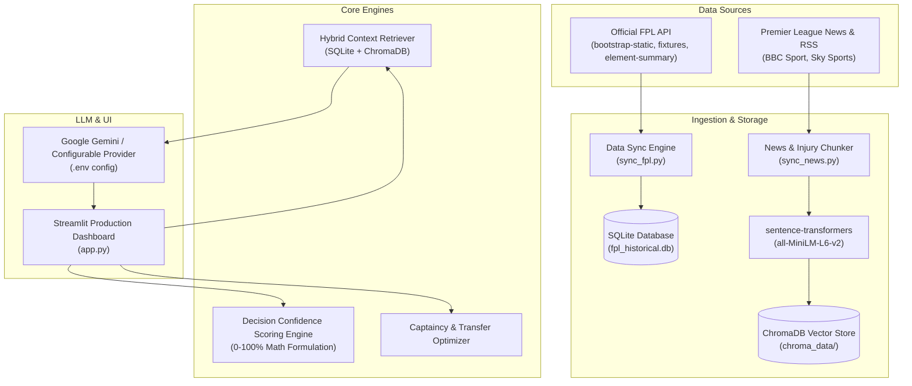

# ⚽ Fantasy Football & Premier League RAG Assistant

A production-quality Decision Support System and Conversational RAG Assistant for Fantasy Premier League (FPL) managers. This application bridges **deterministic quantitative performance metrics** (xG, xA, FDR, ICT Index) with **unstructured real-time qualitative context** (press conference quotes, BBC/Sky Sports news, injury updates) using a hybrid RAG architecture.

---

## 🌟 Key Features

1. **📊 FPL Player Statistics Explorer**: Filter and search through all 660+ active Premier League players by club, position, and price with underlying statistics ($xG$, $xA$, $xGI_{90}$, Points Per Million).
2. **🗓️ Fixtures & FDR Tracker**: Real-time fixture schedule with official Premier League Fixture Difficulty Ratings (FDR 1 to 5) and home/away difficulty indicators.
3. **⚔️ Head-to-Head Player Comparison**: Interactive 6-dimensional Plotly radar chart and side-by-side metric comparison table with winning badges.
4. **🔁 Transfer Decision Evaluator**: Evaluates Player OUT vs Player IN moves, checking bank affordability, schedule swing, expected point delta, and confidence gain.
5. **👑 Captaincy Optimizer (MCDA)**: Multi-criteria decision analysis ranking the top 5 captain picks using form, fixture difficulty, home advantage, and attacking ceiling.
6. **📰 Live News & Injury Radar**: Real-time semantic radar streaming parsed articles from BBC Sport, Sky Sports, and official club medical reports.
7. **💬 Conversational RAG Assistant**: Ask natural-language questions (e.g., *"Is Saka fit to start this weekend?"*, *"Best captain pick for GW6?"*). Injects both structured database stats and verified news documents.
8. **🎯 Decision Confidence Score (0–100%)**: A transparent mathematical formula rating player viability based on form ($25\%$), fixture ease ($25\%$), underlying stats ($20\%$), ROI value ($15\%$), and team delta ($15\%$), penalized by injury and rotation risk.
9. **🔍 Explainable AI Rubric**: Complete breakdown of why a score was produced, detailing positive drivers, drag factors, and applied penalties.
10. **🔄 Live Premier League Delta Sync**: One-click sync button in the UI directly pulls live player rosters, club transfers, goals, and fixtures from the Premier League servers.

---

## 🏗️ System Architecture



---

## 🗄️ Database & Vector Schema

### 1. SQLite Structured Warehouse (`data/fpl_historical.db`)
- `teams`: ID, club name, short name, home/away attack & defence strength ratings.
- `players`: ID, current team ID, position (GKP/DEF/MID/FWD), price, status, injury news, form, xG, xA, current gameweek points, total points.
- `fixtures`: Event (Gameweek 1-38), home/away teams, kickoff time, FDR difficulty (1-5), scores, started/finished flags, and provisional-points status.
- `player_gameweek_history`: Match-by-match breakdown (minutes, goals, assists, bonus, points, xG, xA).

### Live match data and refresh behavior

The official FPL endpoints used are `bootstrap-static` (player totals, current `event_points`, and availability), `fixtures` (scores plus `started`, `finished`, and `finished_provisional`), and `element-summary/{player_id}` (per-fixture player history). Completed fixture rows are aggregated into one record per gameweek; unfinished fixtures are excluded, and provisional FPL points are marked in the player profile. Current gameweek points are stored from the bootstrap response for every player; they are source values and may change until the FPL API finalizes the gameweek. Fixture cards show source scores and distinguish live, provisional, final, and scheduled states.

Player-history fetching rotates through all players in bounded batches during normal syncs. To populate existing missing histories immediately, run `python -m src.ingestion.sync_fpl --history-backfill`. The command first refreshes the official player and fixture data, then fetches each player not yet successfully processed. Progress and failures are stored in SQLite, so rerunning resumes safely; use `--limit N` for a bounded run. Empty source histories do not erase existing records.

When Streamlit is running, its process-wide scheduler checks every 15 minutes on matchdays and every 6 hours otherwise. A matchday is identified by a fixture scheduled for today, a started unfinished fixture, or a provisional fixture kicked off within the last 24 hours; stale provisional flags from earlier rounds do not keep the 15-minute interval active indefinitely. It also checks for stale data at startup. An open dashboard checks the last-success timestamp every 30 seconds and reruns only after a successful background sync. The sidebar's **Sync Fresh FPL Data Now** action performs an immediate synchronized refresh and reports errors/status. Updates do not continue when the Streamlit server process exits; closing only the browser leaves the server running, while computer sleep pauses effective refreshes and shutdown stops them. Use a separate scheduled service if updates are required while this app is stopped.

### 2. ChromaDB Vector Store (`data/chroma_data/`)
- **Collection**: `football_news`
- **Embedding Model**: `sentence-transformers/all-MiniLM-L6-v2` (384-dimensional dense vectors, normalized for cosine similarity).
- **Metadata**: `title`, `source`, `category` (injury, press_conference, transfer), `published_at`, `player_tags`, `team_tags`.

---

## 🚀 Quickstart & Installation

### Option 1: Local Virtual Environment (Recommended)

1. **Clone or navigate to the project directory**:
   ```bash
   cd "flp footba"
   ```

2. **Activate the virtual environment**:
   ```powershell
   # Windows PowerShell
   .\.venv\Scripts\Activate.ps1
   ```

3. **Configure Environment Variables**:
   Copy `.env.example` to `.env`:
   ```bash
   cp .env.example .env
   ```
   Add your free Google Gemini API key from [Google AI Studio](https://aistudio.google.com/):
   ```env
   GEMINI_API_KEY="your_api_key_here"
   LLM_PROVIDER="gemini"
   ```
   *(If left blank, the system automatically uses the offline mock reasoning engine).*

4. **Sync Data & Embeddings**:
   ```bash
   python -m src.ingestion.sync_fpl
   python -m src.ingestion.sync_news
   ```

5. **Launch the Streamlit Dashboard**:
   ```bash
   streamlit run app.py
   ```
   Open your browser at `http://localhost:8501`.

---

### Option 2: Docker Compose Deployment (Linux host with persistent disk)

The Compose setup runs Streamlit and the FPL scheduler as separate containers. Both mount the
same host data directory, and a cross-process lock prevents the scheduler and a manual UI refresh
from writing FPL data concurrently. The scheduler checks every 15 minutes on matchdays and every
6 hours otherwise. It runs historical player ingestion in bounded batches rather than performing
a full backfill on each startup. The app reports worker health from its heartbeat.

Use a supported Linux host where you control Docker Engine and the Compose plugin, with outbound
HTTPS access to the FPL API, configured news sources, and Hugging Face for the embedding model
download on first app startup. Gemini access is also needed if using the live Gemini provider.
Attach a durable local block-storage filesystem; do not put SQLite WAL data on an unverified network filesystem. Docker restart
policies cannot keep services available while the host is stopped, and a bind mount is only as
durable as its underlying disk and backups.

```bash
cp .env.example .env
# Edit .env; never commit it. Set FPL_DATA_DIR to the mounted persistent disk path.
# Keep GEMINI_API_KEY empty for offline/mock mode.
chmod 600 .env
sudo mkdir -p /srv/fpl-assistant/data
# The containers run as UID/GID 10001 and need write access to this directory.
sudo chown 10001:10001 /srv/fpl-assistant/data
sudo chmod 750 /srv/fpl-assistant/data
# Set FPL_DATA_DIR=/srv/fpl-assistant/data in .env before starting Compose.
docker compose up --build -d
```

Compose binds the app only to host loopback (`127.0.0.1:8501`). Put it behind a separately
configured TLS reverse proxy and access-control layer before allowing remote users; do not expose
the Streamlit port directly to the public internet. The current Compose setup does not configure
TLS, authentication, a public hostname, firewall rules, or a hosting account.

The app and worker run the same locally built image tag, so their Python runtime and installed
dependencies are identical for a deployment. The app and worker mount the same directory at
`/app/data` and explicitly use
`/app/data/fpl_historical.db`, `/app/data/chroma_data`, and `/app/data/raw`. Both containers use
the same image source, Python dependencies, and non-root UID/GID 10001. Confirm the mounted host
directory is writable by that UID before startup. Use `docker compose ps` and
`docker compose logs fpl-sync-worker` to inspect service state. The app does not start an embedded
scheduler in external mode. The manual FPL refresh remains available and shares the worker's
cross-process synchronization lock.

#### Moving the existing local data to the host

Do not start Compose against an empty data directory if the existing database and vector
collection must be retained. Stop the local app first. Copy the complete existing `data/`
directory (including `fpl_historical.db`, any SQLite `-wal`/`-shm` files, `chroma_data/`, and
`raw/`) to the mounted host disk, preserving all files. Keep the source copy unchanged. Verify
the destination file inventory, database row counts, and Chroma collection count against the
source before starting either container. Apply the required host ownership to the copied target
only after verifying the copy. If validation fails, leave the original untouched and do not
start Compose with the incomplete destination.

#### Durable data, backup, and recovery

SQLite (`fpl_historical.db` and its WAL/SHM files when present), ChromaDB (`chroma_data/`),
and raw source caches are kept under `/app/data` in the shared host mount. A conservative
consistent backup procedure is:

```bash
docker compose stop fpl-rag-assistant fpl-sync-worker
sudo tar -C /srv/fpl-assistant -czf /secure-backup-location/fpl-data-$(date +%F-%H%M%S).tar.gz data
docker compose start fpl-sync-worker fpl-rag-assistant
```

Store encrypted backups on a different disk or backup service, and monitor that backups complete.
Test recovery without touching the only copy: extract an archive into a separate empty test
directory, point a separate Compose project/configuration at that directory, and verify SQLite
row counts plus the Chroma collection before considering it recoverable. Never extract a test
restore over the live data path. A bind mount does not protect against disk or host loss.

#### Gemini credentials and unavailable Team Delta inputs

Keep `GEMINI_API_KEY` in a permission-restricted, ignored `.env` or inject it from the host's
secrets manager into the environment used to run Compose; do not put credentials in images,
source control, logs, screenshots, or command arguments. The Compose file forwards the key only
to the web app, not the FPL worker. When using `.env`, protect it from other host users and verify
it is not tracked before deployment. Leave the value empty for offline/mock mode. Without a valid
key the assistant uses the offline mock reasoner, which is identified in the UI. A real Gemini
response has not been verified unless a valid key is configured and an actual provider request
succeeds.

The official FPL API currently reports zero for all four team-strength fields across the 20
clubs. The app treats those ratings as unavailable: Team Delta displays `N/A` and is excluded
from the confidence score, with remaining factor weights renormalized. Do not manually seed
invented ratings. This scoring limitation does not prevent the other app features from working.

FPL scheduling is independent of browser visits but still depends on the Linux host, Docker
daemon, attached disk, network, and upstream FPL API being available. The worker heartbeats every
15 seconds after its startup freshness check completes; the web container waits for a healthy
worker before starting. A stale heartbeat makes it unhealthy, and an unexpectedly stopped
scheduler thread causes the worker container to exit so its restart policy can recover it. Synchronization errors
are recorded in SQLite and retried at the next scheduler interval; they do not erase existing
records. Successful data syncs are observed by the app's 30-second last-sync watcher. News
ingestion is available through its manual UI action; the FPL worker does not schedule news
ingestion.

---

## 🧪 Running Automated Tests

Run the complete test suite with `pytest`:
```bash
pytest tests/ -v
```

Tests cover:
- Mathematical accuracy of the Decision Confidence Scoring rubric.
- Penalty multipliers for doubtful and confirmed injured players.
- SQLite repository CRUD, filtering, and fuzzy searching.
- ChromaDB vector chunking, embedding generation, and semantic query matching.

---

## 🎓 College Viva & Presentation Guide

When presenting this project to professors and evaluators, emphasize these key software engineering highlights:

1. **Hybrid RAG vs Pure LLM**: Pure LLMs hallucinate football statistics and lack real-time injury context. Our system grounds every answer in a verified SQLite database and a vector database of fresh press conference reports.
2. **Deterministic Confidence Score**: Rather than letting the LLM invent random recommendations, our `DecisionScoringEngine` computes an objective 0–100 score using statistical metrics ($xGI_{90}$, Form, FDR, PPM) with explicit penalization for injury uncertainty.
3. **Idempotent Data Sync**: The system is future-proof. Running the app 1 year from now pulls the active season's goals, transfers, and fixtures via `ON CONFLICT(id) DO UPDATE` without database corruption.
4. **Local CPU Embeddings**: Using `all-MiniLM-L6-v2` guarantees fast (<15ms) inference on standard laptops without requiring a GPU or paid embedding API credits.

---

## Phase 3 — Grounded FPL Decision Assistant

The AI Assistant now routes supported questions through a deterministic query-understanding layer and an orchestration service (`src/rag/query_understanding.py`, `src/rag/assistant_service.py`). It reuses the existing SQLite repository, ChromaDB collection, MiniLM embeddings, retrieval path, score engine, transfer analyzer, captain picker, and Gemini/offline providers.

### Request flow

```text
Question → intent/player parsing → SQLite player + fixture/history lookup
         → targeted ChromaDB news/injury retrieval → freshness ranking
         → existing Python decision/transfer/captain scoring
         → compact grounded context → Gemini or offline explanation
         → structured metrics + source evidence in Streamlit
```

Structured FPL statistics and all decision scores come from SQLite and the existing Python engines. Gemini explains those outputs; it is instructed not to add facts, dates, fixtures, sources, or scores. The assistant rejects explanations containing numeric claims not present in its grounded context and falls back to a deterministic offline summary. Return dates are shown only when supported by indexed source evidence; relative dates require a dated reference. Missing evidence is reported explicitly. Evidence sources are linked only when an HTTP(S) URL is present in existing metadata.

### Supported question types

- Player statistics, form, availability, and fixtures
- Two-player comparison and multi-gameweek option analysis
- Transfer out/in analysis using both players and the existing transfer scorer
- Captain recommendations using the existing captain ranking engine
- Player injury/availability questions using current FPL status and source-backed return enrichment
- Fixture, gameweek, position, and general FPL questions

Short follow-ups such as “What about Saka instead?” retain the prior transfer-out player in the Streamlit session. Ambiguous player matches are surfaced for clarification rather than selected by popularity.

### Gemini and offline mode

Keep `GEMINI_API_KEY` in `.env` or enter it in the existing password field in the sidebar. The app continues to use the configured `LLM_PROVIDER`; when Gemini is not configured or fails, the existing mock provider keeps structured data, deterministic scores, and retrieved evidence available. API keys are not included in assistant logs or evidence context.

### Example pipeline

For “Should I transfer Haaland out for Gakpo?”, query parsing resolves both FPL players, retrieves both SQLite profiles and their next fixtures, searches ChromaDB separately for each player, scores both using the Python decision engine, and runs the existing transfer analyzer. The UI displays cost impact and deterministic score delta; Gemini receives the compact records and explains the trade-offs. If no matching current news exists, the assistant says so rather than substituting an article.

### Tests

Run the complete mocked and existing test suite from the project environment:

```powershell
pytest tests/ -v
```

Phase 3 routing/orchestration cases live in `tests/test_phase3_assistant.py`; tests mock providers, retrieval, and repository records rather than requiring live APIs or websites.

## Phase 4 — My Team & Gameweek Intelligence

The **🏆 My Team** workspace extends the existing dashboard with a saved, manually managed 15-player squad. It reuses the current FPL player records (including player photos), SQLite repository, fixture data, Decision Confidence Scoring engine, captain picker, transfer analyzer, news vector store, injury enrichment, and configured Gemini/offline provider. No FPL account login is required.

The squad is stored in two additive SQLite tables, `my_team_settings` and `my_team_squad`. Startup initializes these tables without dropping or rebuilding any existing tables or ChromaDB data. Squad checks enforce 2 goalkeepers, 5 defenders, 5 midfielders, 3 forwards, unique players, and the three-per-club limit.

### Phase 4 capabilities

- Manage the starting squad, captain/vice-captain, bench order, purchase prices, bank, and free transfers.
- Recommend a starting XI and formation using the existing deterministic score, availability/news penalties, recent minutes, and attacking involvement.
- Review captain/vice-captain candidates, injury/squad availability, squad health, explainable risk, and fixture difficulty.
- Evaluate single and multi-player transfers, review alternatives, and simulate hypothetical moves without changing the saved squad. Applying a transfer updates only the squad records and settings.
- Analyze the gameweek in one action with squad-wide scores, fixtures, targeted indexed evidence, injury return details when source-backed, alternatives, and an optional grounded LLM explanation.
- Search the existing player pool with natural-language filters and inspect recent form trends and a fixture timeline.

### Phase 4 data flow

```text
Saved squad → SQLite player/history + fixture lookup → targeted ChromaDB evidence
            → existing Python scoring/captain/transfer engines → squad report
            → optional Gemini explanation (or offline result) → Streamlit tabs
```

All displayed decision scores and comparisons are computed in Python by existing engines. The optional LLM explains the prepared report and cannot set or override numeric scores. Injury return dates are only included through the existing source-backed injury parser/reconciler. If evidence is absent, the report indicates that rather than estimating a date. Transfer what-if simulations are read-only until the user explicitly applies a legal and affordable transfer.

### Phase 4 tests

Run `pytest tests/ -v` from the project environment. `tests/test_squad_intelligence.py` uses temporary SQLite storage and mocked repositories, vector retrieval, and providers to cover squad rules, XI/captain selection, transfer legality and simulation, injury evidence, form/risk, fixture timeline, natural-language search, and offline report behavior. No live API or news-site access is needed for tests.
